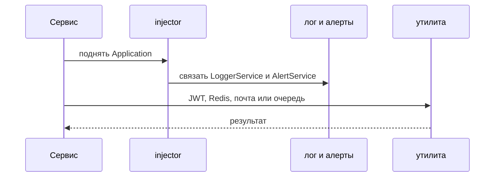

## Описание

`pycore` (`mybootstrap_core_itskovichanton`) — базовый пакет каркаса. В нём протокол `Application`, логи, алерты, валидация, JWT, почта, Redis, RabbitMQ, метрики, OTP и небольшой info-контроллер. Сервис собирает из этих классов своё приложение. Пакет не содержит прикладных сценариев базы.

## Процедуры БД

Процедур базы данных нет. `nested_dict_iter` обходит вложенные словари и к базе не относится.

## Схема работы

## Сценарии

### Сборка приложения из пакета

1. Сервис объявляет свой класс по протоколу `Application`.
2. `injector` связывает `LoggerService` и `AlertService`.
3. Сервис вызывает утилиту пакета: JWT (`generate` / `decode_jwt`), Redis, почту, RabbitMQ, метрики, OTP или info-контроллер.
4. Утилита возвращает результат. Прикладных процедур базы в пакете нет.

# Python app-bootstrap engine

Core classes are placed in this package